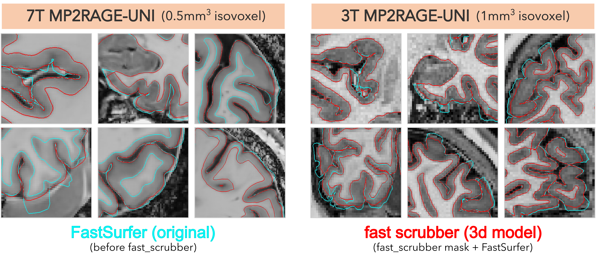

# `fast_scrubber`: Improving brain MRI segmentation at 3T and 7T

## Automated surface QC. Goodbye to all-day manual QC!

[](https://github.com/donnagift/fast_scrubber)
[](https://hub.docker.com/r/micalab/fast_scrubber)
[](https://hub.docker.com/r/micalab/fast_scrubber)
[](https://github.com/donnagift/fast_scrubber/issues)
[](https://github.com/donnagift/fast_scrubber/stargazers)


## The problem

Ultra-high-field MRI preprocessing remains challenging. Standard pipelines can have difficulty accurately segmenting meninges, blood vessels, and adjacent non-brain tissues, leading to systematic errors and extensive manual quality control (QC) of cortical surfaces.
In our 7T dataset, surfaces were generated using FastSurfer, and we observed typical inclusion of meninges, vessels, tentorium, and sinuses. These regions must be manually corrected and the surfaces reprocessed, a step that in our experience can take up to a full day per subject.

## The proposed solution

Our approach is to train a dedicated neural network to improve automated segementation and reduce the burden of manual corrections.This enables:
        - improved segmentation quality in challenging regions
        - reduced manual QC time
        - a more robust preprocessing step that integrates into existing pipelines
  
## About the repository

This repository contains the implementation of nnUNet used to train a model for accurately predicting Fastsurfer-based brain masks. 

## How the model was trained


The model was trained with nnunetv2 2.5.1 on manually quality-controlled surfaces extracted from 7T-MP2RAGE UNI images (0.5 × 0.5 × 0.5 mm³) using Fastsurfer v2.4.2. All brain masks were carefully reviewed by expert raters to ensure high precision and reliability. 
The training set consisted of 129 unique subjects (200 total scans, including multiple sessions), comprising healthy controls and participants with epilepsy or autism, with data drawn in part from the MICA-PNI open-access dataset available in OSF (https://osf.io/mhq3f).
Data were split at the subject level, with an 80/20 train–validation ratio, consistent with the standard nnU-Net 5-fold cross-validation procedure.

We provide these training weights ready to use to predict brain masks, automatically cleaned, hence Fastscrubber, to extract more accurate surfaces.

## Installation

fast_scrubber runs from a conda environment, a Docker image or an Apptainer/Singularity image. All three run the same `fastscrubber.py` with the same pinned packages (PyTorch 2.4.1 with CUDA 12.4, nnU-Net 2.5.1) on Linux x86_64, on a CPU or an NVIDIA GPU. A GPU host needs only an NVIDIA driver: the CUDA runtime ships with the PyTorch wheels.

### Option 1: Conda environment

```bash
PYTHONNOUSERSITE=1 conda env create -f environment.yml
conda activate fastscrubber_env
python download_weights.py
```

`download_weights.py` fetches the model from OSF (https://osf.io/x95g7; dataset.json, plans.json and the five `checkpoint_final.pth`, ~1.2 GB) into `weights/`, checking each file's SHA-256. `PYTHONNOUSERSITE=1` stops packages in `~/.local` from being taken as already installed while the environment is created.

To keep the weights somewhere else (for example, shared between installs), use `python download_weights.py --dest /path/to/weights`. Then pass `--weights /path/to/weights/fast_scrubber/nnUNet_results` to `fastscrubber.py`, or set `FASTSCRUBBER_WEIGHTS` to that path.

### Option 2: Docker

```bash
docker build -t fast_scrubber .
```

The weights are downloaded into the image at build time.

### Option 3: Apptainer / Singularity

Build the image from the Docker image:

```bash
apptainer build fast_scrubber.sif docker-daemon://fast_scrubber:latest
```

`singularity build` works the same way.

## Usage

Prerequisite:
FastSurfer v2.4.2 must be run before executing this pipeline.See the FastSurfer documentation for installation and usage: https://deep-mi.org/research/fastsurfer/ 

1. Predict the brain mask from FastSurfer's `mri/orig.mgz`: give the input image and the output mask.

```bash
fastscrubber.py INPUT OUTPUT [options]
```

   You can pass the `.mgz` directly; no FreeSurfer or `mri_convert` is needed. The mask (0/1) is written to `OUTPUT`, on the same voxel grid as the input. Its extension picks the format: `.nii.gz`, `.nii` or `.mgz`. The output directory is created if needed.

```bash
# conda environment
python fastscrubber.py /path/to/fastsurfer/sub-01_ses-01/mri/orig.mgz /path/to/output/sub-01_ses-01.nii.gz

# Docker (uses a GPU when given --gpus all, otherwise the CPU)
docker run --rm --gpus all --user "$(id -u):$(id -g)" -v /path/to/data:/path/to/data fast_scrubber \
    /path/to/data/fastsurfer/sub-01_ses-01/mri/orig.mgz /path/to/data/output/sub-01_ses-01.nii.gz

# Apptainer / Singularity (uses a GPU when given --nv, otherwise the CPU)
apptainer run --nv -B /path/to/data fast_scrubber.sif \
    /path/to/data/fastsurfer/sub-01_ses-01/mri/orig.mgz /path/to/data/output/sub-01_ses-01.nii.gz
```

   Inside the container, the tool is on `PATH`: `docker run -it --entrypoint bash fast_scrubber`, or `apptainer exec fast_scrubber.sif fastscrubber.py INPUT OUTPUT`.

   From Python (e.g. another workflow), call the same function the command line uses:

```python
from fastscrubber import scrub
scrub("orig.mgz", "sub-01_ses-01.nii.gz", device="cpu", num_cpus=8)
```

| Option | Default | Description |
|---|---|---|
| `INPUT` | required | FastSurfer's `mri/orig.mgz`, or a NIfTI (`.nii.gz`, `.nii`) conversion of it |
| `OUTPUT` | required | Mask to write (`.nii.gz`, `.nii` or `.mgz`) |
| `--device` | `auto` | `auto` (a GPU if one is visible, else the CPU), `cuda`, `cpu` or `mps` (Apple Silicon) |
| `--num_cpus` | available CPUs − 2 | CPU threads, for CPU inference |
| `--folds` | `0 1 2 3 4` | Folds of the 5-fold ensemble to use |
| `--tta` | off | Also predict on mirrored copies and average them (test-time augmentation): up to 8× slower, slightly more accurate. `--disable_tta` is still accepted and changes nothing |
| `--save_probabilities` | off | Also save the softmax maps, to `<OUTPUT without extension>_probabilities.npz` |
| `--weights` | `$FASTSCRUBBER_WEIGHTS`, else `weights/fast_scrubber/nnUNet_results` | Model location |

   By default the tool runs all 5 folds without test-time mirroring. Mirroring (`--tta`) costs up to 8× the time for a very small gain:
   - On 200 7T cross-validation cases scored against manual masks, Dice went from 0.9906 without mirroring to 0.9909 with it.
   - On 10 held-out 7T sessions, the masks made with and without mirroring agreed at Dice 0.9988–0.9992. They differed only within 1 mm of the brain boundary.

   Runtimes:

   | Image | Default (5 folds) | With `--tta` |
   |---|---|---|
   | 0.8 mm 3T, 8 CPU threads | 64–68 min | 8 h 51 min |
   | 0.8 mm 3T, RTX 2060 SUPER GPU | not measured | 17 min, 3 GB of GPU memory |
   | 0.5 mm 7T, RTX 2060 SUPER GPU | 2.4 min | 13.5 min |

   For quick checks, use `--folds 0`, a fifth of the default work: ~9 min for a 0.8 mm 3T image on 32 CPU threads.

   Notes:
   - Docker runs as root unless given `--user "$(id -u):$(id -g)"`, so outputs would otherwise be owned by root.
   - With `apptainer run --containall`, bind a scratch directory to `/tmp` (`-B /scratch:/tmp`): the tool keeps its temporary files there.
   - The model was trained on FastSurfer-conformed images (LIA voxel order). The tool warns when an input is not in that orientation; raw scanner T1w images are not a supported input.

2. Apply the fast_scrubber-generated mask using `run_fastscrubber.sh`. This scripts internally calls FastSurfer v2.4.2 `recon-surf.sh`, so FastSurfer must already be installed and configured. It expects the mask at `<inference_dir>/sub-<SUBJECT_ID>_ses-<SESSION_ID>.nii.gz`, so name the output of step 1 that way.
   
```bash
./run_fastscrubber.sh sub-<SUBJECT_ID> ses-<SESSION_ID> \
/path/to/fastsurfer_directory/ \
/path/to/inference_dir
```

## Testing

- `.github/workflows/ci.yml` runs on every pull request. It builds the conda environment, the Docker image and the Apptainer image, and runs `fastscrubber.py` through each on a small image made from a public BIDS T1w (OpenNeuro ds000001): from the command line, inside the containers, and as the Python function `scrub()`. Every mask is checked with `tests/check_mask.py`.
- `.github/workflows/bids-ci.yml` runs `tests/bids_ci_test.sh` on the lab runner, using the lab's BIDS_CI dataset (`/data/mica3/BIDS_CI/rawdata`). For each subject it conforms the T1w with FastSurfer 2.4.2's own `conform.py`, which reproduces FastSurfer's `orig.mgz` exactly. It then runs `fastscrubber.py` from the environment, Docker and Apptainer, and checks that every mask is valid and that the runtimes agree. You can also run the script by hand:

```bash
FASTSCRUBBER_PYTHON=$(which python) FASTSCRUBBER_WEIGHTS=$PWD/weights/fast_scrubber/nnUNet_results \
FASTSCRUBBER_DOCKER=fast_scrubber FASTSCRUBBER_SIF=fast_scrubber.sif ./tests/bids_ci_test.sh
```

## Some example outputs
<p align="center">
  
</p>


## To train your own model
For detailed instructions on training a custom model, please consult the nnUNet documentation. In summary, you will need to: 

#### 1. Create a conda environment for the nnUNet and follow the installation instructions here: 
> https://github.com/MIC-DKFZ/nnUNet

#### 2. Sort your data and paths according to: 
[setting_up_paths.md](https://github.com/MIC-DKFZ/nnUNet/blob/master/documentation/setting_up_paths.md)
[dataset_format.md](https://github.com/MIC-DKFZ/nnUNet/blob/master/documentation/dataset_format.md)
[set_environment_variables.md](https://github.com/MIC-DKFZ/nnUNet/blob/master/documentation/set_environment_variables.md)

#### 3. Copy training images & labels, and test images from Fastsurfer outputs to new directory

Convert `mgz` files to `nii` files before copying

| **Category**   | **Description**                               | **Data Type**         |
|----------------|-----------------------------------------------|-----------------------|
| `imagesTr`     | `orig.mgz` ground truth images for training   | Training images       |
| `labelsTr`     | `orig.mgz`  binarized ground truth images     | Ground truth labels   |
| `imagesTs`     | `orig.mgz` - images to predict                | Testing images        |


## Run the model

### Check data
```bash
nnUNetv2_plan_and_preprocess -d DATASET_ID --verify_dataset_integrity >> e.g. nnUNetv2_plan_and_preprocess -d 500 --verify_dataset_integrity
```

### Train data
```bash
nnUNetv2_train DATASET_NAME_OR_ID UNET_CONFIGURATION FOLD --npz 
```

> Example:

```bash
TORCHDYNAMO_DISABLE=1 OMP_NUM_THREADS=1 nnUNetv2_train 500 2d 0 --npz   
```
> or

```bash
TORCHDYNAMO_DISABLE=1 OMP_NUM_THREADS=1 nnUNetv2_train 500 3d_fullres 0 --npz –device cuda
```

> run it for 5 folds (0-4), and with different configurations (2d, 3d_lowres, 3d_fullres)- 0

### choose best model

```bash
nnUNetv2_find_best_configuration DATASET_NAME_OR_ID -c CONFIGURATIONS 
```

> Example:

```bash
nnUNetv2_find_best_configuration 500 -c 2d 3d_lowres 3_fullres
```

## Run 3D inference | *best model*

```bash
 nnUNetv2_predict \
 -i <path>/7T_NNunet/nnUNet_raw/Dataset500_Segmentation/imagesTs \
 -o <path>/7T_NNunet/nnUNet_results/Dataset500_Segmentation/nnUNetTrainer__nnUNetPlans__3d_fullres/inference \
 -d 500 -c 3d_fullres --save_probabilities
```

## Citation
Cabalo DG, Rodriguez R, DeKraker J, Kebets V & Bernhardt B.fast_scrubber. Retrieved from osf.io/x95g7

For the segmentation method used: 
Isensee, F., Jaeger, P. F., Kohl, S. A., Petersen, J., & Maier-Hein, K. H. (2021). nnU-Net: a self-configuring 
method for deep learning-based biomedical image segmentation. Nature methods, 18(2), 203-211.
